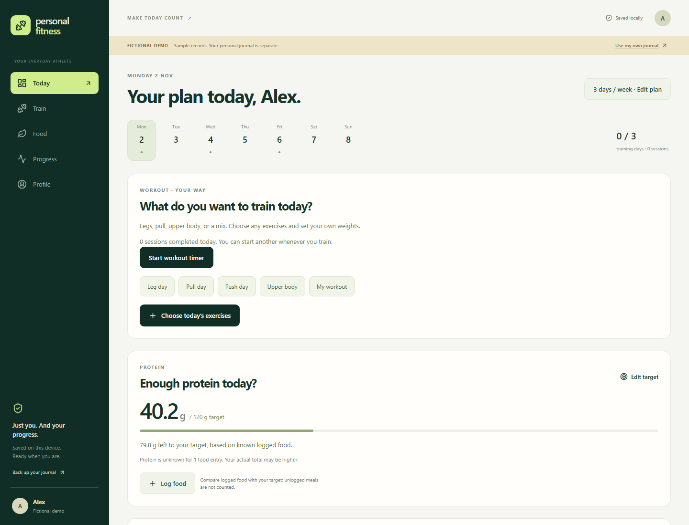

# Personal Fitness

A private, offline fitness journal that connects your gym sessions, food, and recovery.

Choose what you want to train, record your weights/sets/reps, and check your daily protein against a target. Keep workout and food records privately on your device.

**React + JavaScript. No TypeScript. No account or backend required.**



## What works

- Choose leg, pull, push, upper, or mixed sessions. Select any exercises, configure sets/reps/weight, reorder them, or create your own exercise.
- Start a workout timer before selecting exercises, stop with a save/discard/continue choice, reorder or remove unused movements, and keep separate sessions on the same day.
- Enter kg or lb. Original pound entries are retained and converted to kilograms for consistent history.
- Build your own 1–7-day schedule (including upper/lower and multiple sessions per day). Completed working exercises become reusable workouts.
- Log Malaysian foods by serving count, or save a custom meal with just the nutrition you know for one serving.
- Set a protein-only target without a calorie setup. See grams recorded, grams remaining, and when the logged target is reached.
- Repeat a previous workout, add movements during an active session, and review saved history and strength trends.
- Correct an exercise mistakenly saved in completed history, with confirmation and updated progress/routine records.
- Track weekly direct muscle days across gym and home, set per-group goals (such as twice weekly), and choose ideas for groups below target. Optional Android reminders check unfinished targets.
- Guided set logging with weight/reps carried forward; exercise swaps and advanced tools stay available.
- Optional 2–5-day suggested programs and explainable progression remain available.
- Malaysian food first: 25 local references and familiar portions, plus 20 USDA ingredients, custom labels, and recipes.
- Offline photo meals: take or select a picture, confirm foods and portions, and save it with your food records. Photo review happens on the device.
- Optional nutrition targets, nutrient coverage, cardio, hydration, and waist/strength trends.
- IndexedDB storage, a production offline shell, and encrypted backup/restore.
- Separate fictional demo mode. Your real journal starts empty.

## Run locally

Use Node.js 24 LTS and npm.

```sh
npm ci
npm run dev
```

Open **http://127.0.0.1:5174**. Choose **Explore fictional demo** to look around without entering personal details.

```sh
npm test
npm run build
npm run preview
# One-time browser setup for end-to-end tests:
npx playwright install chromium
npm run test:e2e
```

Production offline support requires a successful first visit on HTTPS or localhost. The Android edition bundles the same web UI. The private native project, APKs, toolchains, signing keys, and personal records are deliberately excluded from this web repository.

## Learn more

- [Purpose and user guide](docs/PRODUCT.md)
- [Architecture and development](docs/ENGINEERING.md)
- [Recommendation rules and evidence](docs/RULES.md)
- [Privacy and backup behavior](docs/PRIVACY.md)
- [Verification results and device-testing limits](docs/VALIDATION.md)
- [Malaysian food sources and portion estimates](docs/FOOD-DATA.md)
- [Weekly muscle tracking and Android reminders](docs/WEEKLY-MUSCLES.md)
- [Flexible workouts, load units, timers, and photo meals](docs/WORKOUTS-AND-PHOTO-MEALS.md)

This is a personal fitness tool for adults, with transparent rules rather than a trained AI coach. It does not diagnose injuries or nutrient deficiencies. Food composition and energy targets are estimates. Cloud sync, wearables, barcode scanning, and store publication are not part of this version.

## Copyright

© 2026 fitrirusli. All rights reserved. Original project code, design, and documentation are provided for portfolio review; reuse requires permission as described in [LICENSE](LICENSE). Third-party libraries and food sources retain their respective rights, licenses, and attribution.
